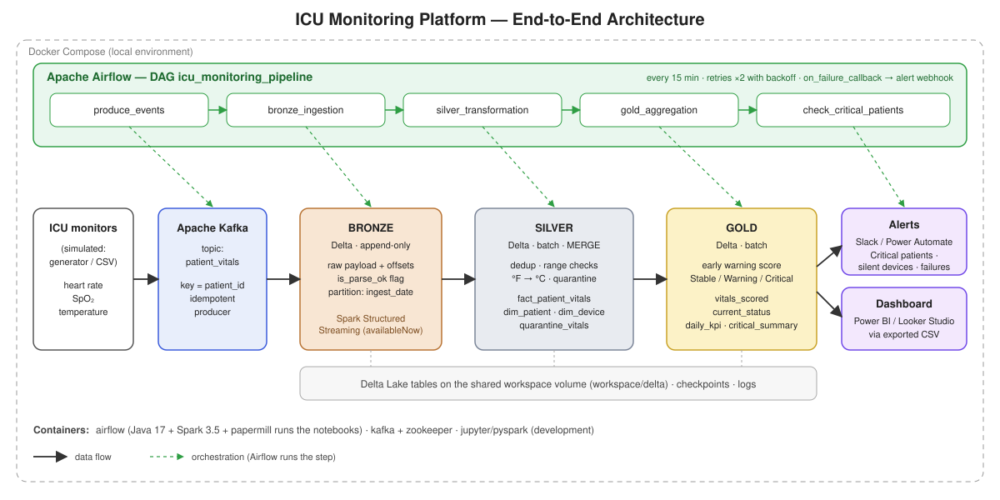
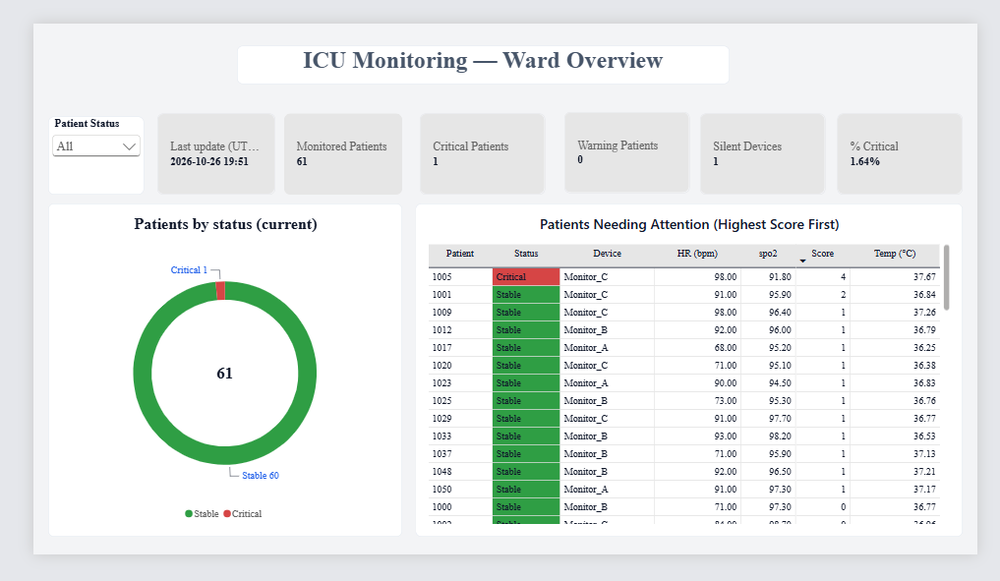
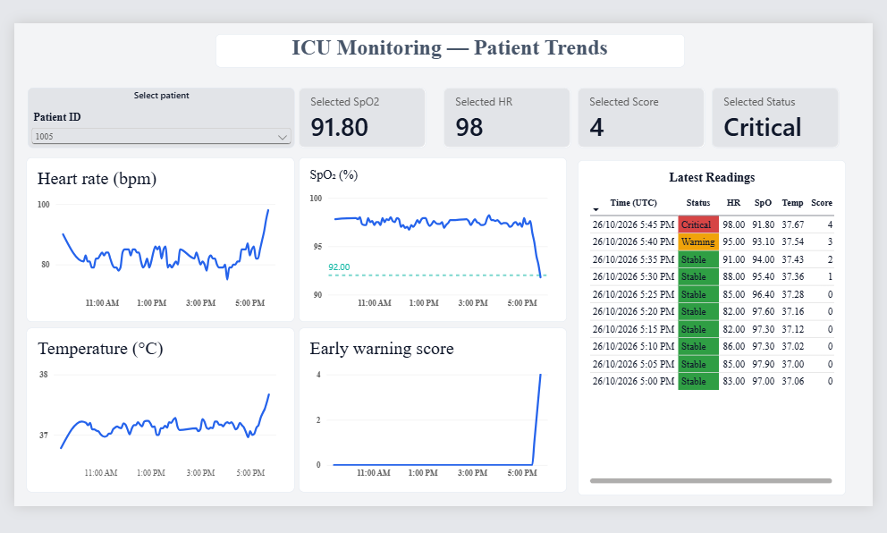
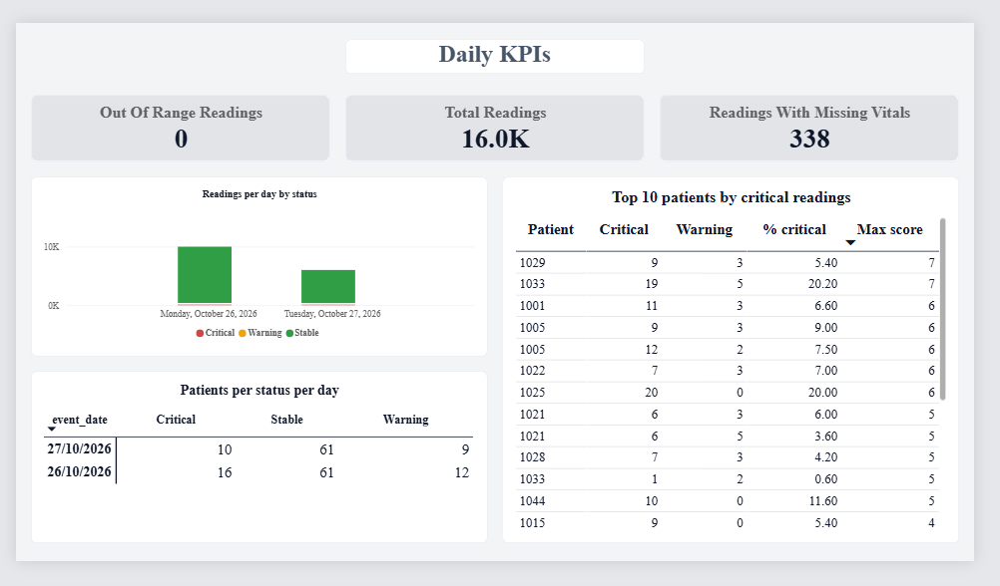
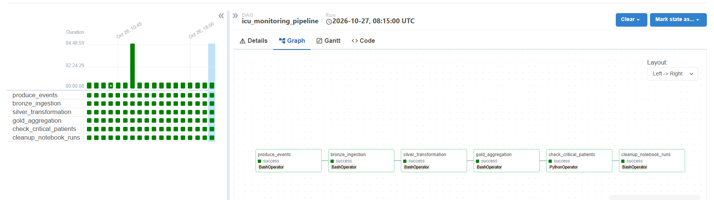

# ICU Monitoring Data Platform (Capstone — MantisAI Data Engineering)

End-to-end data platform for ICU vital signs (heart rate, SpO₂, temperature): events are streamed through Kafka, stored in a Delta Lake medallion architecture, cleaned and scored with Spark, and served to a Power BI dashboard and an alert log. Airflow orchestrates every step on a 15-minute schedule.

> **Disclaimer:** all data is **synthetic**. The patient status is a *simplified early warning score adapted from NEWS2* (heart rate, SpO₂ and temperature only). It is decision support for a training project, has not been clinically validated and must not be used for real patient care. See [ADR-002](docs/adr/ADR-002-patient-status-in-gold.md).

## Architecture



| Layer | Technology | What it does |
|---|---|---|
| Source | `icu_simulator.py` (default) or `healthcare_producer.py` (CSV replay) | Simulates the bedside monitors and publishes events to Kafka |
| Ingestion | Apache Kafka, topic `patient_vitals` | Buffers events, keyed by `patient_id` |
| Bronze | Spark Structured Streaming → Delta Lake | Append-only raw data with Kafka offsets and a parse flag |
| Silver | PySpark batch → Delta Lake | Deduplication, range checks, °F→°C, quarantine, star schema |
| Gold | PySpark batch → Delta Lake | Early warning score, current status, daily KPIs; CSV exports for BI |
| Orchestration | Apache Airflow (runs the notebooks with papermill) | Schedule, retries, alerts, run history |
| Consumption | Power BI Desktop (from the exported CSVs) | Three-page dashboard |
| Alerts | Alert log file, task logs, optional webhook | Critical patients, silent devices, pipeline failures |

Design decisions are recorded as ADRs, and the scope is documented:
* [Scope, user stories and success metrics](docs/scope_user_stories_metrics.md)
* [ADR-001 Medallion architecture](docs/adr/ADR-001-medallion-architecture.md)
* [ADR-002 Patient status in the Gold layer](docs/adr/ADR-002-patient-status-in-gold.md)
* [ADR-003 Airflow orchestration](docs/adr/ADR-003-airflow-orchestration.md)

## Data

**Source:** patient ids and devices come from the dataset `data/icu_vitals.csv` — *[dataset name and link]* — columns `patient_id, timestamp, device_id, heart_rate, spo2, temperature, temp_unit`.

**Live simulator (default).** Every run publishes new synthetic readings: one per patient for every 5-minute slot since the previous run. It includes occasional deterioration episodes (SpO₂ falls, status goes Warning then Critical, then recovers), silent devices, missing values, Fahrenheit readings, missing units and duplicate messages, so every downstream rule is exercised. TThe first run starts at the current 5-minute slot, and the dataset keeps growing from then on for as long as the DAG runs (a pause is filled when it resumes, up to one day)., and the dataset keeps growing for as long as the DAG runs. The simulator keeps its state in `workspace/simulator_state.json`.

**CSV replay (optional).** `SOURCE_MODE=replay` replays the historical CSV instead.

**Tables**
* Bronze: `bronze_patient_vitals` (raw payload, Kafka coordinates, `bronze_ingested_at`, `is_parse_ok`).
* Silver: `silver_fact_patient_vitals` (one row per `patient_id + device_id + event_ts`), `silver_dim_patient`, `silver_dim_device`, `silver_quarantine_vitals`.
* Gold: `gold_patient_vitals_scored`, `gold_patient_current_status`, `gold_daily_patient_kpi`, `gold_critical_status_summary`.

**Silver cleaning rules** (constants at the top of the silver notebook): heart rate 20–250 bpm, SpO₂ 50–100 %, temperature 30–45 °C after normalization. Out-of-range values become NULL with an `*_out_of_range` flag. If `temp_unit` is missing, the unit is inferred from the value range and `temp_unit_missing` is set.

**Status rule (Gold).** Each vital scores 0–3 points; **Critical** = total ≥ 5 or any single vital scores 3; **Warning** = total 3–4; **Stable** otherwise; **Unknown** if all vitals are missing. Details and thresholds: ADR-002.

## Repository layout

```
.
├── dags/icu_pipeline_dag.py        # Airflow DAG (documented in its docstring)
├── data/icu_vitals.csv             # source dataset (mounted read-only into Airflow)
├── docker-compose.yml              # Airflow (custom image), Kafka, Zookeeper, Jupyter/PySpark
├── README.md 
├── docs/
│   ├── adr/                        # architecture decision records
|   ├──dashboard/                      # Power BI file (.pbix)
│   ├── screenshots/                # dashboard and Airflow screenshots
│   ├── architecture.svg
│   ├── powerbi_measures.dax        # DAX measures (backup)
│   ├── powerbi_setup.md            # Power Query and model setup
│   └── scope_user_stories_metrics.md
└── workspace/
    ├── icu_simulator.py            # live synthetic data generator (default source)
    ├── healthcare_producer.py      # CSV replay producer (SOURCE_MODE=replay)
    ├── bronze_ingestion.py
    ├── silver_transformation.py
    ├── gold_aggregation.py
    └── delta/ checkpoints/ exports/ logs/ notebook_runs/ alerts/    # generated at runtime (git-ignored)
```

## How to deploy and run

**Prerequisites:** Docker Desktop (Compose v2.17+), about 8 GB of RAM available to Docker, and internet access on the first run (Spark downloads the Kafka and Delta jars). Power BI Desktop (Windows) for the dashboard.

1. **Copy Spark from the Jupyter image** (the Airflow image reuses it so versions match). Done once; `spark-dist/` is git-ignored:
   ```bash
   docker compose up -d pyspark
   docker compose exec pyspark ls -d /usr/local/spark*        # find the real folder name
   docker compose cp pyspark:/usr/local/spark-3.5.0-bin-hadoop3 ./spark-dist
   ```
2. **Start everything:**
   ```bash
   docker compose up -d --build
   ```
3. **Open Airflow** at <http://localhost:8085> (user `admin`):
   ```bash
   docker exec icu_monitoring cat /opt/airflow/standalone_admin_password.txt
   ```
4. **Run the pipeline:** enable the DAG `icu_monitoring_pipeline` (or click *Trigger*). The first run starts at the current 5-minute slot; every later run adds one reading per patient per slot, so the dataset grows from the moment the pipeline is started (a pause is filled when it resumes, up to one day).
5. **Results:** Delta tables in `workspace/delta/`, CSV exports for BI in `workspace/exports/`, alerts in `workspace/alerts/alerts.jsonl`, logs in `workspace/logs/`, executed notebooks of each run in `workspace/notebook_runs/` (deleted after 48 hours).

**Stop and reset (clean start)**
```bash
docker exec icu_monitoring airflow dags pause icu_monitoring_pipeline      # stop scheduling
docker compose down        # also removes the Kafka topic and the Airflow history (no volumes are used)
```
Then delete `workspace/delta`, `workspace/checkpoints`, `workspace/exports`, `workspace/notebook_runs`, `workspace/alerts` and `workspace/simulator_state.json` **together** (the checkpoint and the simulator state must be deleted with the tables and the Kafka topic), and start again with `docker compose up -d`.

**Configuration** (environment variables read by the DAG)

| Variable | Default | Meaning |
|---|---|---|
| `SOURCE_MODE` | `simulator` | `simulator` or `replay` |
| `STALE_MINUTES` | `20` (simulator) | A patient with no reading for this long is flagged as a silent device |
| `ALERT_WEBHOOK_URL` | empty | Optional webhook (Slack, Discord, Power Automate HTTP trigger) |

## Scheduling and alerting

**DAG `icu_monitoring_pipeline`** runs every 15 minutes (`*/15 * * * *`), one run at a time, without catch-up:

`produce_events → bronze_ingestion → silver_transformation → gold_aggregation → check_critical_patients → cleanup_notebook_runs`

* **Retries:** every task retries twice with exponential backoff (2 to 10 minutes) and has an execution timeout.
* **Failure alerts:** any failed task calls `on_failure_callback`, which records an alert.
* **Business alerts:** `check_critical_patients` reads the exported current-status table and records an alert when patients are `Critical` or devices have stopped sending data (`is_stale`).
* **Where alerts go:** every alert is written to the task log and appended to `workspace/alerts/alerts.jsonl` (one JSON line per alert, no account needed). If `ALERT_WEBHOOK_URL` is set, it is also posted there as `{"text", "title", "severity"}`. E-mail and Power Automate were **not** configured in this project; the webhook hook is ready for them.
* **Reliability by design:** idempotent Kafka producer, Silver deduplication and `MERGE` (re-runs never duplicate rows), quarantine of unusable records, append-only bronze for replay, simulator state saved only after every message was delivered.

## Cost and performance notes

* The project runs locally in Docker, so there is no cloud cost. On a cloud deployment the same design maps to object storage (S3/ADLS/GCS) with Delta, managed Spark (Glue/Dataflow/Synapse/Databricks), managed Kafka and managed Airflow. These services are **not** used here.
* Bronze runs with the `availableNow` trigger: each run drains the Kafka backlog and exits, which avoids an always-on streaming cluster at the price of freshness equal to the schedule interval (15 minutes) plus run time.
* Silver and gold recompute from the full upstream table on every run (simple and correct at this size). Processing only new data by `bronze_ingested_at` is the first scaling step.
* Measured on the development machine : patients 61, rows in the silver fact table 121,first run 6.10 min, typical run 5.45 min (producer 0.1, bronze 1.14, silver 1.43, gold 2).

## Limitations and future improvements

* Synthetic data and a simplified score (three vitals); full NEWS2 needs respiration rate, blood pressure and consciousness, and the thresholds need clinical review.
* Freshness equals the DAG interval; a continuous streaming bronze plus incremental silver and gold would give near real-time updates.
* Alerts are written to a log (optionally a webhook) and repeat on every run while a patient stays Critical; e-mail or Power Automate delivery and "new alerts only" logic are next steps.
* The Power BI Desktop report is refreshed manually after each run.
* `SequentialExecutor` (Airflow standalone, SQLite) is for development; production would use the Celery or Kubernetes executor and PostgreSQL.
* Notebooks executed with papermill should become tested Python packages; add unit tests for the scoring logic and automated data-quality checks.


## Dashboard

**Ward overview**
Built in Power BI Desktop from the gold CSV exports (setup: [docs/powerbi_setup.md](docs/powerbi_setup.md)). The report file is in [`dashboard/`](dashboard/); to open it on another machine, change the `ExportsPath` parameter to your `workspace/exports` folder.



**Patient trends**



**Daily KPIs**



**Successful pipeline run in Airflow**

